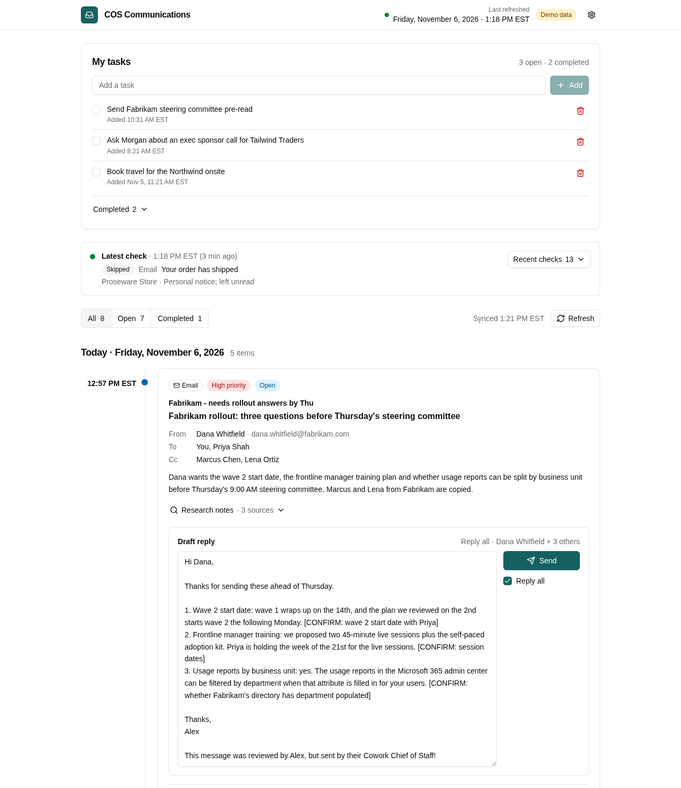

# COS Communications Dashboard

A private Chief of Staff dashboard for Microsoft 365 Copilot Cowork. Cowork automations screen every email
and Teams chat against your Chief of Staff constitution, research the answer, and draft a reply in your
voice. This page shows them day by day so you can review, edit and send each reply, mark it complete or
delete it, and keep your own task list on the same page.



**Try it:** [open the demo](https://brentwhichel.github.io/cos-dashboard/?demo) to see it with fictional data, then follow the
[setup guide](https://brentwhichel.github.io/cos-dashboard/setup.html) to build your own.

- **Dashboard:** https://brentwhichel.github.io/cos-dashboard/
- **Demo:** https://brentwhichel.github.io/cos-dashboard/?demo
- **Setup guide:** https://brentwhichel.github.io/cos-dashboard/setup.html

Anyone can use the hosted dashboard with their own data. It runs entirely in your browser and connects only
to your own OneDrive folder or Microsoft 365 account; nothing you open in it is sent to this site or this
repository. You can also [publish your own copy](#publish-your-own-copy-on-github-pages).

## What you get

- **My tasks** at the top: add, complete, reopen and delete your own to-dos.
- **Latest check**, with a full run log: every automation run shows up, even when nothing needed you, and
  the page warns you when the automations look paused.
- **A day-by-day timeline** of the emails and Teams chats that need you, each with priority, why it matters,
  a summary, who's on it, private research notes, and a researched draft reply.
- **Send with a 5-second undo**, Reply all, add people to a reply (external recipients flagged), Mark
  Complete, Reopen, Delete with undo, and All / Open / Completed filters.

Nothing is ever sent unless you press **Send** on a specific item.

## How it works

```
 Watch (Cowork automations)         Store (your OneDrive)                    Act (this page)
 ─────────────────────────          ─────────────────────────────            ────────────────────────
 Inbox email screening      ──┐     Documents/Cowork/COS Comms Dashboard/    My tasks
 Customer email screening   ──┤──►    comms-feed.json   (items + run log) ──► Latest check
 Key-person chat alerts     ──┤       dashboard-state.json  ◄───────────────  Review, edit, send
 Scheduled Teams sweep      ──┘       my-tasks.json         ◄───────────────  Complete / delete
                                      teams-sweep.json
```

The page has no server. It runs in your browser and reads your own files, so each person sees only their
own email, chats and tasks.

## Set up your own dashboard

Open the **setup guide** (`setup.html`) and follow Steps 1 to 7. It fills your details into every prompt:

1. **Constitution.** Tell Cowork how to act as your Chief of Staff.
2. **Private feed.** Cowork creates the folder and files in your OneDrive.
3. **Open the dashboard.** Connect it one of three ways (below).
4. **Email screening.** Every new email is added with a draft or skipped with a reason.
5. **Customer email.** An Outlook rule plus its own screening, so every customer email lands on the dashboard.
6. **Key people.** Instant capture and a private self-chat alert for the few people who can't wait.
7. **Teams sweep.** A scheduled sweep of every chat, every customer message and every @mention.

Then audit after the first week (Step 10) and tune weekly. The same prompts are in [`prompts/`](prompts),
and [`docs/facilitator-guide.md`](docs/facilitator-guide.md) is a 60-minute plan for walking someone else
through it.

## Three ways to connect

| | OneDrive folder | Microsoft 365 sign-in | Inside Cowork |
|---|---|---|---|
| Setup | None. Sync OneDrive, use Edge or Chrome | One-time app registration by IT ([steps](docs/microsoft-365-sign-in.md)) | Paste one prompt ([details](cowork-app/README.md)) |
| Reads your feed | From the synced folder | From OneDrive | From OneDrive |
| Replies | **Copy & open**: copies the draft and opens the message in Outlook or Teams | **Send** from your own Outlook and Teams | **Send** through your own connections |
| Works on | This computer | Any computer | Cowork |

## Publish your own copy on GitHub Pages

1. Create a new **public** repository on GitHub (for example `cos-dashboard`).
2. Upload everything in this folder to the repository's `main` branch (**Add file › Upload files**, then drag
   in the folder contents, including the hidden `.nojekyll` file).
3. In the repository, open **Settings › Pages**. Under **Build and deployment**, choose **Deploy from a
   branch**, pick `main` and `/ (root)`, and select **Save**.
4. After a minute or two, open `https://<your-github-user>.github.io/<repo>/`.
5. Optional: to turn on Microsoft 365 sign-in for everyone, set `clientId` and `tenantId` in
   [`config.js`](config.js). See [`docs/microsoft-365-sign-in.md`](docs/microsoft-365-sign-in.md).

To change the prompts, edit [`assets/prompts.js`](assets/prompts.js) and run `node tools/build-prompts.js` to
refresh the Markdown copies in `prompts/`.

## Privacy and security

- No server, no analytics, no data in this repository. The page reads your feed in your browser and talks
  only to your own Microsoft 365 (`graph.microsoft.com`, `login.microsoftonline.com`) when you sign in.
- Settings, the folder you picked, and sign-in tokens are stored only in your browser.
- Every piece of feed text is rendered as text, never as HTML, and only `http`, `https`, `mailto` and `tel`
  links become clickable.
- `config.js` is public. Never put secrets or personal information in it; an application (client) ID is not
  a secret.

## Repository layout

| Path | What it is |
|---|---|
| `index.html`, `config.js` | The dashboard |
| `setup.html` | The step-by-step setup guide |
| `assets/` | Page code and styles (`app.js`, `core.js`, `styles.css`), the setup guide (`setup.js`, `setup.css`), all prompts (`prompts.js`) and the fictional demo data |
| `prompts/` | Every setup prompt as Markdown |
| `docs/` | Feed format, Microsoft 365 sign-in, facilitator guide |
| `starter-files/` | Empty copies of the four feed files |
| `cowork-app/` | Source for the optional in-Cowork version of the dashboard |
| `tools/build-prompts.js` | Rebuilds `prompts/` from `assets/prompts.js` |
| `.github/workflows/publish-kit-update.yml` | Lets the repository owner publish kit updates from Cowork; safe to delete in your copy |

All names and companies in the demo are fictional.
